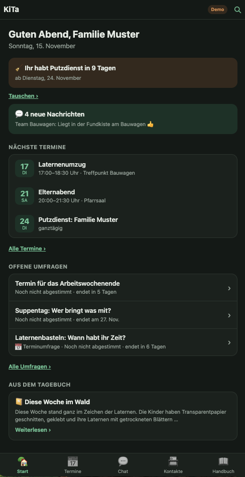
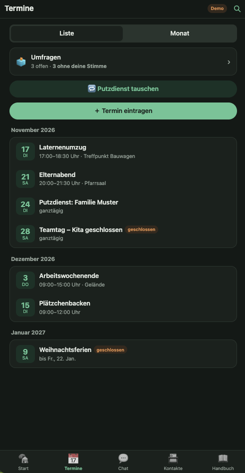
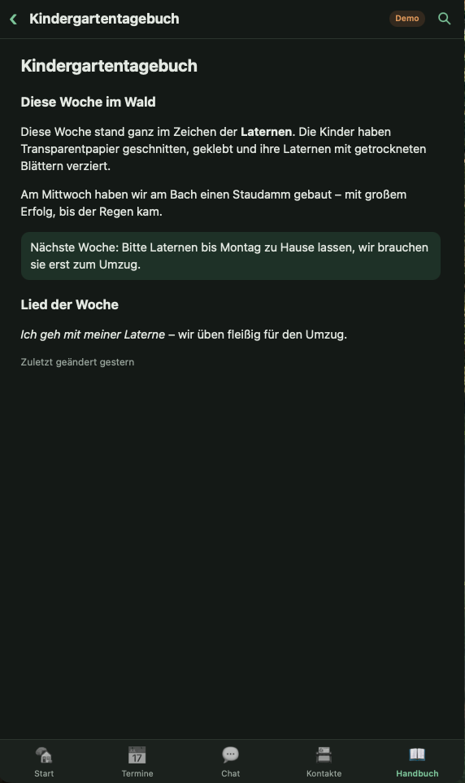
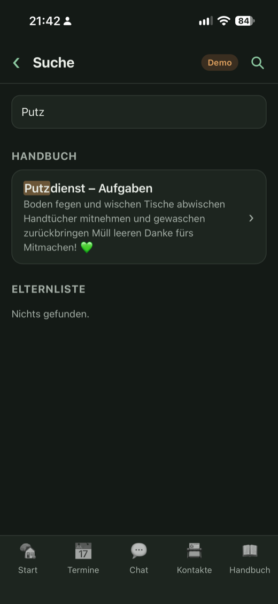

# KiTa-App

A mobile-first parents' app for kindergartens and parent-run childcare initiatives, built as a
[Nextcloud](https://nextcloud.com/) app. It gives parents what they need every day in one lean interface for the
smartphone, and it installs on the home screen like an app (PWA, no app store).

It grew out of a parent-run forest kindergarten in Bavaria and is released under the AGPL-3.0 so that other
initiatives can use and improve it. Contributions are very welcome.

**[Try the live demo](https://thecocoashop.github.io/kita-app/)** (made-up data; best on a phone or in a narrow browser window).

<p align="center">
  
  
  
  
</p>

> The user interface is **German** only for now. Translations would be a great first contribution.
> Deutsche Fassung: [README.md](README.md)

## Features

| Area | What it does | Built on |
|---|---|---|
| Events | Calendar, staff can add and edit events, month view | Calendar (CalDAV) |
| Chat | Group and staff chats | Talk |
| Polls | Text and date polls, parents can create their own | Polls |
| Handbook | Parents' handbook with images, full-text search | Collectives |
| Parent list | Contacts with children, call and mail | Contacts (CardDAV) |
| Swap cleaning duty | Families swap shifts, the server updates the calendar | own table and CalDAV |
| Announcements | Notices on the start page, optional mail | own settings |
| Weekly digest | Diary with cover photo and a mail to all parents | Collectives, mail |
| Absence reports | Parents report a child as absent, staff see a daily list | own table |
| Search | One search box for handbook and parent list | none |

The app stores almost nothing itself. All data stays in your own Nextcloud, there are no third-party cloud services
and no telemetry.

## Requirements

- Nextcloud 30 to 35 with the apps Calendar, Contacts, Talk, Polls and Collectives
- Outgoing mail configured in Nextcloud (for notifications)
- Optional: [Immich](https://immich.app/) for photo albums (cover photo of the weekly digest)

## Install

Step by step in [nextcloud/INSTALL.md](nextcloud/INSTALL.md) (German). In short:

```bash
bash nextcloud/build.sh                       # builds nextcloud/kitaapp.tar.gz
# unpack it into custom_apps/ on your server, then:
occ app:enable kitaapp --groups admin         # try it with admins first
occ config:app:set kitaapp org_name  --value="Example Kindergarten e.V."
occ config:app:set kitaapp org_short --value="Example Kindergarten"
occ app:enable kitaapp                        # then enable for everyone
```

Everything specific to your institution (name, sender and contact addresses, photo server URL, group names)
is configured through app settings, not in the code.

## Privacy

- Absence reports store only the first name, the period and the kind (sick, holiday, other). No free text, no diagnosis.
  They are visible only to the family itself and to staff and board, and old entries are deleted automatically.
- A login is matched to a family through the email address on the parent's contact card.
- The repository contains no credentials and no real personal data. The demo data is made up.

## Known quirks

- German UI texts live directly in `kita-app/app.js` and the PHP services. There is no translation file yet.
- The weekly digest mail wording (greeting, sign-off) is written for a forest kindergarten (`DiaryService.php`).
- Default group and calendar names follow our own setup (for example the group `Team-Kita`). All can be changed with `occ config:app:set`.

## Contributing

Open an [issue](../../issues) for bugs and ideas (please never paste real names, children's data or credentials),
or send a pull request with a short explanation. See [CONTRIBUTING.md](CONTRIBUTING.md) (German).
Security problems: use "Report a vulnerability" on the Security tab.

## License

GNU Affero General Public License v3.0 or later, see [LICENSE](LICENSE). If you modify the app and run it for others,
you must make your changes available under the same license.
