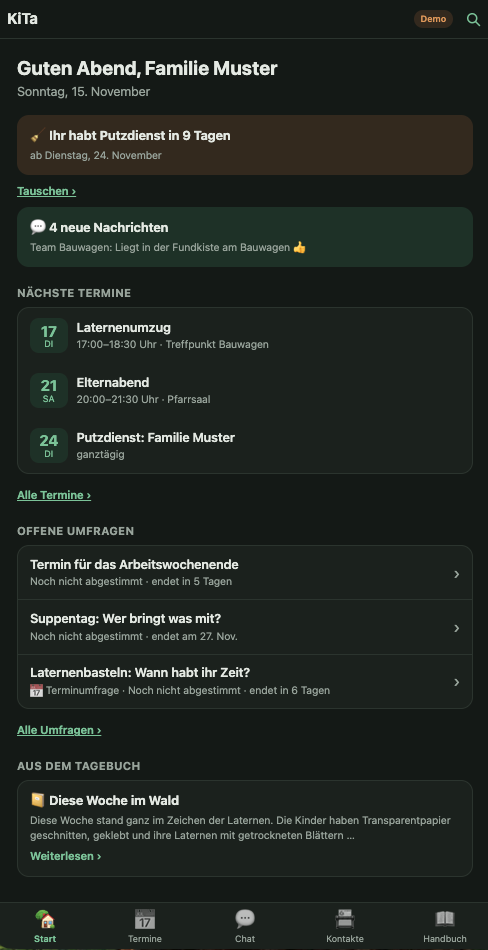
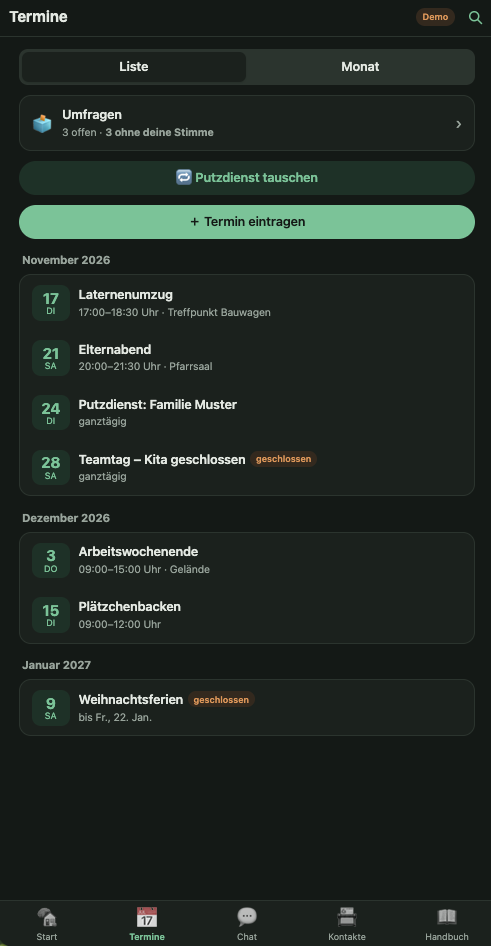
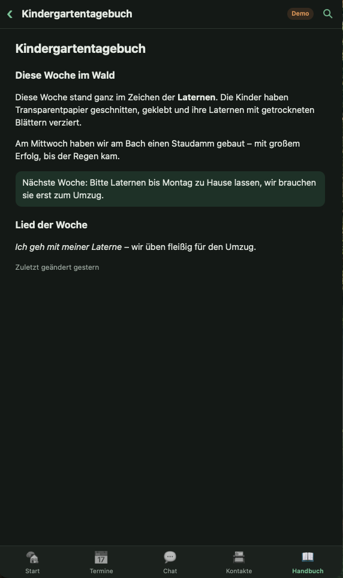
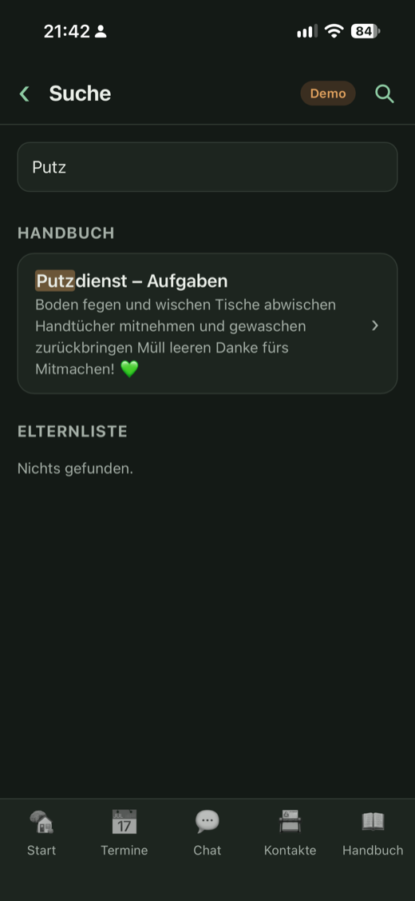

# KiTa-App

Eine handyfreundliche Eltern-App für Kindergärten und Elterninitiativen, gebaut auf einer eigenen
[Nextcloud](https://nextcloud.com/). Sie zeigt, was Eltern täglich brauchen, in einer schlichten Oberfläche
für das Smartphone, und lässt sich wie eine App auf dem Homescreen installieren (PWA, kein App-Store).

Entstanden im Naturkindergarten Dießen e.V., einer Elterninitiative. Die Idee dahinter: weniger Abhängigkeit von
proprietären Systemen und Apps und ein Ausweg aus dem WhatsApp-Dilemma (Datenschutz, DSGVO). Für öffentliche Stellen ist
WhatsApp datenschutzrechtlich in der Regel nicht zulässig. Mit der KiTa-App liegen die Daten auf eigenen oder in der EU
gehosteten Servern.

Freigegeben unter AGPL-3.0, damit auch andere Elterninitiativen sie nutzen und verbessern können. Mitmachen ist
ausdrücklich erwünscht.

*English in short: a mobile-first parents' app for kindergartens, implemented as a Nextcloud app (PHP backend plus a
dependency-free JavaScript front end). German UI. AGPL-3.0. Issues and pull requests welcome.*

**English:** [README.en.md](README.en.md)

**[Demo ansehen](https://thecocoashop.github.io/kita-app/)** (mit erfundenen Daten). Am Computer erscheint die App in einem Handyrahmen, am Handy ohne.

<p align="center">
  
  
  
  
</p>

## Was sie kann

| Bereich | Inhalt | Nextcloud-Baustein |
|---|---|---|
| Termine | Kalender, Eintragen und Bearbeiten durch das Team, Monatsansicht | Kalender (CalDAV) |
| Chat | Gruppen- und Teamchats | Talk |
| Umfragen | Text- und Terminumfragen, auch neue anlegen | Polls |
| Handbuch | Elternhandbuch mit Bildern, Suche | Collectives |
| Elternliste | Kontakte mit Kindern, anrufen, mailen | Kontakte (CardDAV) |
| Putzdienst tauschen | Familien tauschen Dienste, der Server schreibt den Kalender | eigene Tabelle und CalDAV |
| Meldungen | Hinweise auf der Startseite, optional per Mail | eigene Einstellungen |
| Wochenrückblick | Tagebuch mit Titelbild und Mail an die Eltern | Collectives, Mail |
| Abwesenheit | Eltern melden ihr Kind ab, das Team sieht die Tagesliste | eigene Tabelle |
| Suche | Lupe durchsucht Handbuch und Elternliste | – |

Die App speichert fast nichts selbst. Alle Daten bleiben in der eigenen Nextcloud. Es gibt keine Cloud-Dienste von Dritten
und selbstredend keine Datenübermittlung an uns.

## Voraussetzungen

- Nextcloud 30 bis 35 mit den Apps Kalender, Kontakte, Talk, Polls und Collectives
- Ausgehende Mail in der Nextcloud (für Benachrichtigungen)
- Optional: Immich für Fotoalben (Titelbild im Wochenrückblick)

## Einrichten

Schritt für Schritt in [nextcloud/INSTALL.md](nextcloud/INSTALL.md). Kurzfassung:

```bash
bash nextcloud/build.sh                       # baut nextcloud/kitaapp.tar.gz
# auf dem Server nach custom_apps/ entpacken, dann:
occ app:enable kitaapp --groups admin         # erst nur für Admins testen
occ config:app:set kitaapp org_name  --value="Kindergarten Beispiel e.V."
occ config:app:set kitaapp org_short --value="Kindergarten Beispiel"
occ app:enable kitaapp                        # dann für alle
```

Angaben zur Einrichtung (Name, Absender, Kontaktadressen, Foto-Adresse) stehen in den App-Einstellungen, nicht im Code.
Die Namen der Gruppen (Vorstand, Team, Eltern) und der Kalender lassen sich ebenfalls einstellen.

## Raus aus WhatsApp: unsere Erfahrungen

Wie wir den Umstieg angehen, welche Hürden es gibt und was uns hilft, steht im [Erfahrungsbericht](docs/umstieg.md). Für Vereine, die über denselben Schritt nachdenken.

## Datenschutz

- Die Abwesenheitsmeldung speichert nur Vorname, Zeitraum und Art (krank, Urlaub, sonstiges), ohne Freitext und ohne Diagnose.
  Sichtbar ist sie nur für die Familie selbst, das Team und den Vorstand. Alte Meldungen werden automatisch gelöscht.
- Die Zuordnung Login zu Familie läuft über die Mailadresse in der Elternkarte der Kontakte.
- Im Repository liegen keine Zugangsdaten und keine echten Personendaten. Die Demo-Daten sind erfunden.

## Bekannte Eigenheiten

- Die Oberfläche ist deutsch. Texte stehen direkt in `kita-app/app.js` und den PHP-Diensten, eine Übersetzungsdatei gibt es noch nicht.
- Der Text der Wochenrückblick-Mail (Gruß, Unterschrift „…und den Waldfeen“) ist auf unseren Waldkindergarten zugeschnitten
  (`DiaryService.php`). Wer das ändern will, passt die Texte dort an.
- Standardwerte für Gruppen und Kalender orientieren sich an unserem Aufbau (z. B. Gruppe „Team-Kita“). Alle sind per `occ config:app:set` änderbar.

## Mitmachen

- Fehler und Wünsche als [Issue](../../issues) melden. Bitte keine echten Namen, Kinderdaten oder Zugangsdaten posten.
- Verbesserungen als Pull Request. Kurz beschreiben, was sich ändert und warum.
- Fragen und Erfahrungsberichte aus anderen Einrichtungen sind willkommen.

Siehe auch [CONTRIBUTING.md](CONTRIBUTING.md).

## Lizenz

GNU Affero General Public License v3.0 oder später, siehe [LICENSE](LICENSE). Wer die App verändert und für andere
betreibt, muss seine Änderungen ebenfalls unter dieser Lizenz zur Verfügung stellen.
